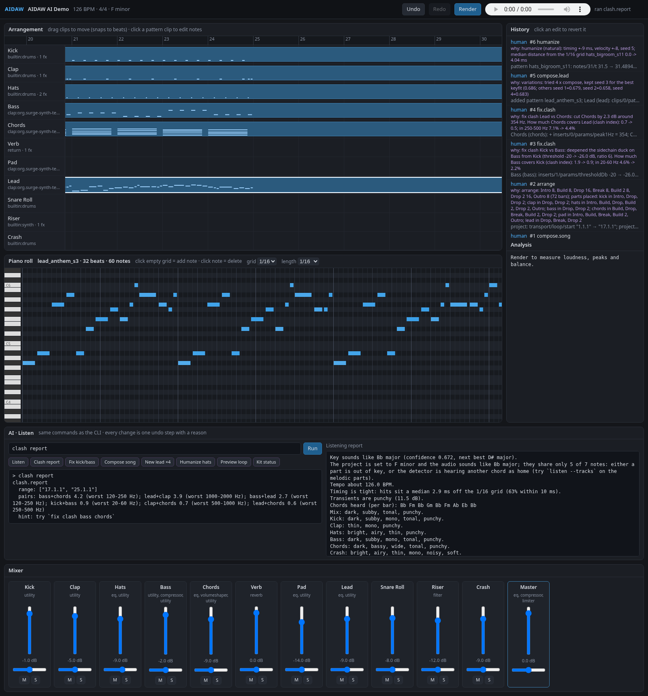

# AIDAW

An AI-specialist DAW: a small, free, open-source DAW that a person and an AI can both drive, with or without a screen. It listens to its own renders, takes musical commands, searches a sound library, and ships a free synth and sampler kit. (The Python package and CLI are still called `plaindaw`; `aidaw` is the same command.)

- **Plain-text projects.** A song is a folder with a readable `project.json` (tempo map, patterns, tracks, clips, plugins, sends, automation, markers). Diff it, put it in git, edit it by hand.
- **One op layer.** Every change goes through the same named operations (`track.add`, `mix.set`, `pattern.add_notes`, `auto.shape`, …). The CLI, JSON-RPC, the MCP server and the browser GUI all call these same ops.
- **Shared undo history with reasons.** Every edit is logged in `history/ops.jsonl` with who made it (`human`, `ai`, or `external`) and, for musical commands, why. Undo, redo, or revert one specific older edit. Lock tracks or patterns so the AI can't touch them.
- **Listening.** `listen` reports key and chords, tempo and beat grid, timing tightness, transients, a timbre description per track, and section energy, in plain English plus JSON. `--reference song.wav` compares the mix with a track you like.
- **Musical commands.** `compose`, `arrange`, `fix clash`, `variations`, `humanize` and `preview` compile to ordinary ops: one undo step each, with the reason logged.
- **Sound library.** `lib scan` indexes presets (Surge `.fxp`, `.vstpreset`, `.sfz`, and others) and samples, auto-tags samples by listening to them (kick, loop, 120 bpm, C minor, bright…), then `lib search` / `lib audition` / `lib use`.
- **Bundled kit.** `kit install` fetches Surge XT (synth) and sfizz (sampler) plus a small CC0 piano and strings set, verifies checksums and registers them, so `compose` uses Surge XT sounds by name. Without the kit everything falls back to the deterministic built-ins.
- **Deterministic offline render** with the built-ins. Exports WAV (16/24/32-bit float), FLAC and AIFF built in; MP3, OGG, Opus and M4A through ffmpeg.
- **The AI "hears" through numbers.** Each render can also return LUFS (integrated/short-term/momentary), true peak, LRA, crest, stereo width, low-end mono check, band balance, loudness per section and per track, masking hints and targets.
- **Plugins.** Built-in synth, drums, sampler and SFZ player; 11 built-in effects. External **VST3** (through pedalboard) and **CLAP** (own small C host), each in its own process so a crash can't take the session down.
- **Gets along with other DAWs.** MIDI import/export (FL Studio, Ableton and others), stem import, stem export.



## Install

Requires Python 3.10+. ffmpeg on PATH is needed only for MP3/OGG export and for importing MP3/M4A files.

```bash
git clone https://github.com/SnazzyGaz/AIDAW && cd AIDAW
python -m venv .venv && . .venv/bin/activate      # Windows: .venv\Scripts\activate
pip install -e .            # add [test] for the test suite
```

Environment overrides: `PLAINDAW_FFMPEG` (full path to ffmpeg.exe instead of PATH), `PLAINDAW_HOME` (library index and auditions, default `~/.plaindaw`), `PLAINDAW_LIBRARY` (index file), `PLAINDAW_KIT` (kit folder), `PLAINDAW_PLUGIN_PATH` (extra plugin folders), `PLAINDAW_PLUGIN_SKIP` (`;`-separated glob patterns of plugins never listed or loaded; default `WaveShell*;*Waves*`, empty to skip nothing), `PLAINDAW_PLUGIN_PROBE` (`1`/`0`: whether scanning may instantiate plugins; off by default on Windows, where plugin loaders can pop up licence or activation dialogs; VST3 class ids are read from `moduleinfo.json` instead).

CLAP hosting compiles a small C library the first time it's used. That needs `gcc`/`clang` (on Windows, MinGW-w64 gcc or MSVC `cl`). VST3 and the built-ins work without a compiler.

## 60-second tour

```bash
plaindaw new mysong --bpm 126 --title "My Song"
cd mysong                                   # or pass -p mysong to every command

plaindaw track add Kick --plugin builtin:drums
plaindaw pattern add four --lengthBeats 4
plaindaw pattern fill four C2 1             # a kick on every beat
plaindaw clip add_pattern kick four 1.1.1 --repeat 8

plaindaw track add Bass --plugin builtin:synth --params "wave=saw cutoff=500 sub=0.5"
plaindaw clip add_notes bass 1.1.1 --notes "F2@0.5:0.4 F2@1.5:0.4 F2@2.5:0.4 F2@3.5:0.4" --repeat 8
plaindaw plugin add bass builtin:compressor --sidechain kick --params "thresholdDb=-24 ratio=6"
plaindaw mix set bass --gain -3

plaindaw render --formats wav,mp3 --target club     # writes renders/ and prints the analysis
plaindaw history
plaindaw undo
plaindaw gui                                         # opens the browser GUI
```

Positions are `bar.beat.16th` (1-based: `1.1.1` is the start, `9.1.1` is bar 9) or a number of quarter notes. Inside patterns, `t` and `len` are quarter notes (`0.25` = a 16th). Notes take MIDI numbers (60 = C4) or names (`F#3`). The compact note form is `KEY@START[:LEN[:VEL]]`.

`plaindaw ops` lists every op with its arguments; `--json` gives machine-readable output; `--dry-run` previews a change; `plaindaw run script.pdaw` runs one command per line.

## AI tour

```bash
plaindaw kit install                                   # optional: Surge XT + sfizz + piano/strings (about 260 MB)
plaindaw new song --bpm 128 && cd song

plaindaw compose song --genre bigroom --key "F minor" --chords "i VI III VII" --seed 11
plaindaw listen                                        # key, chords, tempo, timing, timbre, section energy
plaindaw listen --bars 17-24 --reference ../ref.wav    # compare a section with a reference track
plaindaw clash report                                  # which pairs fight, in which band
plaindaw fix clash kick bass                           # sidechain/EQ, shows before -> after, keeps it only if it helped
plaindaw variations 4 compose lead --target keyfit     # try 4 leads, keep the best (or --keep list)
plaindaw variations 5 mix set pad --vary gainDb=-12..0 --target clarity
plaindaw humanize hats --feel natural
plaindaw preview --bars 17-20 --tracks kick,bass       # quick solo render to renders/preview.wav
plaindaw history                                       # every step with its "why:"
```

- `compose <part>`: `bass`, `chords`, `pad`, `lead`, `arp`, `drums` or `song`, with `--genre` (bigroom, house, techno, dnb, trap, hiphop, lofi, ambient, …), `--key`, `--chords` (roman numerals or chord names), `--bars`, `--style` (e.g. offbeat, reese, 808, supersaw, pluck, anthem), `--seed`, `--engine auto|builtin|surge|sfz`. Same seed, same notes. Recomposing an arranged part swaps its pattern in every section.
- `arrange --form "intro:8,build:8,drop:16,break:8,build:8,drop:16,outro:8"` lays out the composed parts, adds markers, snare rolls, risers with filter sweeps, crashes and per-section levels.
- `variations` metrics: loudness, punch, brightness, darkness, width, clarity, keyfit, energy, contrast, tightness; `--target metric=value` aims at a number.
- `instrument add surge --preset "Bass 1"`, `instrument add sfizz --sfz piano`, or any `vst3:`/`clap:` plugin.
- Listening uses NumPy/SciPy only. Extra listeners (e.g. an embedding model) plug in with `PLAINDAW_LISTENERS=module:function`; their output lands under `extra` in the report.

## Sound library

```bash
plaindaw lib scan ~/Samples "D:/BotWorkshop/Presets"   # incremental; no paths = the kit
plaindaw lib search "dark bass" --engine surge
plaindaw lib search loop --bpm 124 --key "F minor"
plaindaw lib audition <id>                             # renders a short phrase or the sample
plaindaw lib use <id> --track Bass                     # puts it on a track (one undo step)
```

Index: `~/.plaindaw/library.json` (or `PLAINDAW_LIBRARY`). Surge `.fxp`, `.vstpreset` (needs the matching VST3 installed to audition), `.sfz` and audio are playable; other preset files (`.vital`, `.h2p`, `.nmsv`, VST2 `.fxp`) are indexed by name and folder only.

## The kit (Surge XT + sfizz)

```bash
plaindaw kit install            # or: kit install surge sfizz sfz
plaindaw kit status
plaindaw kit clean              # delete the downloaded archives
```

It downloads the official release builds for your OS (Linux, Windows, macOS), checks each file against pinned md5/sha256 or git hashes, and writes `kit/kit.json`. The kit lives in the app folder (`<AIDAW>/kit`, always so on Windows and never under `C:\Program Files`), otherwise `~/.local/share/plaindaw/kit`, or wherever `PLAINDAW_KIT` points. On Linux sfizz is built from its official source release (needs cmake and a C++ compiler, about a minute). Licences and checksums: `THIRD_PARTY.md`. Renders that use Surge XT are not bit-identical run to run; the built-ins are.

## Demo songs

`examples/demo/build_demo_ai.pdaw` writes a whole big-room track with the musical commands (compose, listen, fix clash, variations, humanize); `examples/demo/AIDAW_AI_Demo.mp3` is its render with the kit installed (Surge XT sounds).

```bash
plaindaw new demo-ai --bpm 126 --title "AIDAW AI Demo"
plaindaw -p demo-ai run examples/demo/build_demo_ai.pdaw
plaindaw -p demo-ai render --formats wav,mp3
```

`examples/demo/build_demo.pdaw` builds a short original track (F minor, 126 BPM, 18 bars: intro, build with snare roll and riser, drop, outro) using only commands, then runs a mix pass based on what the analysis reported. `examples/demo/PlainDAW_Demo.mp3` is the render.

```bash
plaindaw new demo --bpm 126 --title "PlainDAW Demo"
plaindaw -p demo run examples/demo/build_demo.pdaw
plaindaw -p demo render --formats wav,mp3 --target club --stems true
```

## Live playback and MIDI

Install the extra once: `uv pip install -e ".[live]"` (sounddevice for audio, mido + python-rtmidi for MIDI).

* **Transport**: the GUI header has Home / Play / Stop / Loop / Click / Rec, the position (bar.beat.tick) and a
  readout of render state, output, latency and CPU. Click the ruler to move the playhead; drag on the ruler to set
  the loop range (snaps to bars). Space plays/pauses, Home rewinds, M toggles the click, Q the loop, R record.
* **From anywhere**: `aidaw -p song play`, `stop`, `seek 5.1.1`, `transport.loop on`, `metronome on`, `status`;
  JSON-RPC `transport.*`; MCP tools `transport` and `play_note`. When the GUI is running, the CLI and the AI
  drive the GUI's engine, so you hear what they do.
* **Live notes**: plug in a MIDI keyboard and pick it under *Audio & MIDI* (it plays the selected track), or use
  the computer keys A W S E D F T G Y H U J K O L (Z/X change octave), or press the keys on the piano roll.
  Rec + Play records what you play into the pattern under the playhead (or a new 2-bar pattern) as one undo step,
  quantized to the chosen grid.
* **Audio device**: pick the output and buffer size under *Audio & MIDI* (`aidaw devices`, `audio.set`).
  WASAPI/DirectSound/MME work out of the box; set `PLAINDAW_ASIO=1` before starting to list ASIO drivers.
  Latency shown = PortAudio's output latency + one buffer.

How it works, honestly:
* The timeline is **rendered ahead** with the same renderer that writes files, in a background thread, and
  streamed. With loop on, only up to the loop end is rendered and reverb tails fold back onto the loop start.
  Edits trigger a re-render that only redoes the tracks that changed (instrument, sample and plugin output is
  cached), then crossfades in at the playhead: well under a second for built-in instruments, longer for
  Surge XT / VST3 tracks. It is not per-buffer plugin processing.
* **Live notes are real time** for built-in synth and drums. Plugin and SFZ tracks are previewed with a stand-in
  built-in synth (`standIn` in the reply); recorded notes still play back through the real plugin. Live notes get
  the track's fader and pan, not its insert effects.
* Without an audio device (servers, tests) a silent "null" output runs the same engine.

## For AI assistants (MCP)

```bash
plaindaw -p mysong mcp            # MCP server over stdio
```

Example client config (Claude Desktop, Cursor and others):

```json
{ "mcpServers": { "plaindaw": { "command": "plaindaw", "args": ["-p", "/path/to/mysong", "mcp"] } } }
```

Tools: `project_overview`, `get_project`, `list_ops`, `edit`, `batch`, `get_pattern`, `render`, `analyze`, `listen`, `compose`, `arrange`, `fix_clash`, `clash_report`, `variations`, `humanize`, `preview`, `instrument_add`, `lib_search`, `lib_scan`, `lib_audition`, `lib_use`, `kit_status`, `undo`, `redo`, `revert`, `history`, `diff`, `list_plugins`, `plugin_params`, `export_midi`. `edit` and `batch` take an optional `reason`. Edits are tagged `ai` in history. `plaindaw --mode read-only -p mysong mcp` lets the AI look without editing. `--mode ask` makes it confirm destructive ops first.

## JSON-RPC and HTTP

```bash
plaindaw -p mysong rpc            # JSON-RPC 2.0, one request per line on stdin/stdout
plaindaw -p mysong serve          # http://127.0.0.1:8765 : GUI, POST /rpc, GET /events (live changes)
```

Methods are the op names plus queries (`project.summary`, `render`, `analyze`, `history.undo`, …); `rpc.discover` lists them all, including `listen`, `compose`, `fix.clash`, `lib.search` and `cli.exec` (runs one CLI command line; the GUI's AI panel uses it). Add `"_as": "ai"` to params to tag the author.

## Plugins

```bash
plaindaw plugins                                      # scan VST3/CLAP folders (+ PLAINDAW_PLUGIN_PATH)
plaindaw track add Lead --plugin "vst3:Serum"         # VST3 by name
plaindaw track add Surge --plugin clap:org.surge-synth-team.surge-xt
plaindaw plugin params --plugin "vst3:Serum"
plaindaw plugin set_params lead instrument --params '{"cutoff": 0.4}'
```

## FL Studio round trip

Export MIDI (`plaindaw export midi --out song.mid`) and stems (`render --stems true`) and drag them into FL Studio. To bring FL work back, import its MIDI (`plaindaw import midi song.mid`) or rendered stems (`plaindaw import stems a.wav b.wav`).

## Project layout

```
mysong/
  project.json        the song (canonical, stable formatting)
  media/              imported audio, content-addressed (sha256)
  states/             plugin state blobs
  history/ops.jsonl   every edit, with forward and inverse patches
  renders/            audio, analysis JSON, stems (git-ignored)
```

JSON Schema: `plaindaw/schema/project.schema.json`.

## Tests

```bash
pip install -e .[test]
pytest
```

The suite covers the timebase, patch/undo properties, the ops and history (locks, permissions, revert conflicts), render determinism and mixing math, sidechain, audio-clip timing and stretch, loudness against pyloudnorm and the EBU reference, export formats, MIDI round trip, CLAP and VST3 hosting, crash isolation, the CLI, JSON-RPC (stdio and HTTP + SSE), MCP with the official client SDK, the browser GUI in headless Chrome (including the AI panel), the demo songs, and the AI parts: theory, listening (tempo, timing, key, chords, timbre, reference comparison, listener plugins), compose determinism and undo, arrange, fix clash, variations, humanize and swing, preview, locks, the SFZ player, library scan/tag/search/audition/use, the kit (mapping, pins, fallback, and real Surge XT + sfizz renders when the kit is installed). Surge XT tests run when Surge XT is installed (`PLAINDAW_THIRDPARTY`).

## Status

Version 0.2 (AI features + kit). Tested on Linux, including the kit install and Surge XT / sfizz renders. Windows and macOS kit downloads are wired up with pinned checksums but not tested yet. Known weak spots: chord detection can mistake a chord for its relative (Db heard as Fm); `fix clash` on a whole song is slow, so it defaults to the loop. Version 0.1 notes: tested on Linux. Windows and macOS paths are in place (plugin folders, CLAP loader, compiler detection) but not tested yet. Not real-time: there is no live playback engine or audio-device recording. Playback means rendering and then playing the file (the GUI does this for you).

## Credits and licence

Created by **Garyck Arntzen** ([@_mintydoge](https://x.com/_mintydoge)).

GPL-3.0-or-later (see `LICENSE`). Third-party software and sounds the kit downloads are listed with their licences in `THIRD_PARTY.md` (Surge XT GPL-3.0, sfizz BSD-2-Clause, VSCO 2 CE samples CC0). Uses pedalboard (GPLv3), NumPy, SciPy, soundfile, mido, and the CLAP headers (MIT, included under `plaindaw/native/third_party/clap-include`).
