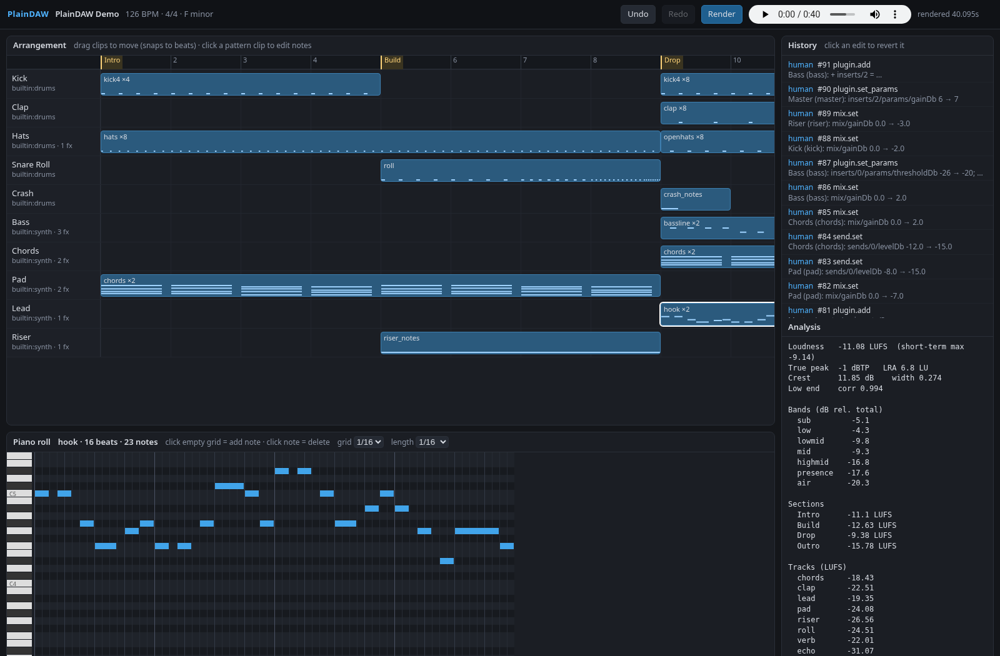

# PlainDAW

A small, free, open-source DAW that a person and an AI can both drive, with or without a screen.

- **Plain-text projects.** A song is a folder with a readable `project.json` (tempo map, patterns, tracks, clips, plugins, sends, automation, markers). Diff it, put it in git, edit it by hand.
- **One op layer.** Every change goes through the same named operations (`track.add`, `mix.set`, `pattern.add_notes`, `auto.shape`, …). The CLI, JSON-RPC, the MCP server and the browser GUI all call these same ops.
- **Shared undo history.** Every edit is logged in `history/ops.jsonl` with who made it (`human`, `ai`, or `external` for hand edits). Undo, redo, or revert one specific older edit. Lock tracks or patterns so the AI can't touch them.
- **Deterministic offline render.** Render the same project twice and you get the same samples. Exports WAV (16/24/32-bit float), FLAC and AIFF built in; MP3, OGG, Opus and M4A through ffmpeg.
- **The AI "hears" through numbers.** Each render can return an analysis: integrated/short-term/momentary LUFS, true peak, LRA, crest, stereo correlation and width, low-end mono check, band balance, spectral centroid, loudness per section (from markers) and per track, masking hints, plus targets (club, streaming, podcast, film).
- **Plugins.** Built-in synth, drums and sampler; built-in EQ, filter, compressor (with sidechain), limiter, gate, reverb, delay, chorus, distortion, utility and volume shaper. External **VST3** (through Spotify's pedalboard) and **CLAP** (our own small C host). Each external plugin runs in its own process, so a crashing plugin is bypassed with a warning and doesn't take the session down.
- **Gets along with other DAWs.** MIDI import/export (FL Studio, Ableton and others), stem import, stem export.



## Install

Requires Python 3.10+. ffmpeg on PATH is needed only for MP3/OGG export and for importing MP3/M4A files.

```bash
git clone <this repo> plaindaw && cd plaindaw
python -m venv .venv && . .venv/bin/activate      # Windows: .venv\Scripts\activate
pip install -e .            # add [test] for the test suite
```

CLAP hosting compiles a small C library the first time it's used. That needs `gcc`/`clang` (on Windows, MinGW-w64 gcc or MSVC `cl`). VST3 and the built-ins work without a compiler.

## 60-second tour

```bash
plaindaw new mysong --bpm 126 --title "My Song"
cd mysong                                   # or pass -p mysong to every command

plaindaw track add Kick --plugin builtin:drums
plaindaw pattern add four --lengthBeats 4
plaindaw pattern fill four C2 1             # a kick on every beat
plaindaw clip add_pattern kick four 1.1.1 --repeat 8

plaindaw track add Bass --plugin builtin:synth --params "wave=saw cutoff=500 sub=0.5"
plaindaw clip add_notes bass 1.1.1 --notes "F2@0.5:0.4 F2@1.5:0.4 F2@2.5:0.4 F2@3.5:0.4" --repeat 8
plaindaw plugin add bass builtin:compressor --sidechain kick --params "thresholdDb=-24 ratio=6"
plaindaw mix set bass --gain -3

plaindaw render --formats wav,mp3 --target club     # writes renders/ and prints the analysis
plaindaw history
plaindaw undo
plaindaw gui                                         # opens the browser GUI
```

Positions are `bar.beat.16th` (1-based: `1.1.1` is the start, `9.1.1` is bar 9) or a number of quarter notes. Inside patterns, `t` and `len` are quarter notes (`0.25` = a 16th). Notes take MIDI numbers (60 = C4) or names (`F#3`). The compact note form is `KEY@START[:LEN[:VEL]]`.

`plaindaw ops` lists every op with its arguments; `--json` gives machine-readable output; `--dry-run` previews a change; `plaindaw run script.pdaw` runs one command per line.

## Demo song

`examples/demo/build_demo.pdaw` builds a short original track (F minor, 126 BPM, 18 bars: intro, build with snare roll and riser, drop, outro) using only commands, then runs a mix pass based on what the analysis reported. `examples/demo/PlainDAW_Demo.mp3` is the render.

```bash
plaindaw new demo --bpm 126 --title "PlainDAW Demo"
plaindaw -p demo run examples/demo/build_demo.pdaw
plaindaw -p demo render --formats wav,mp3 --target club --stems true
```

## For AI assistants (MCP)

```bash
plaindaw -p mysong mcp            # MCP server over stdio
```

Example client config (Claude Desktop, Cursor and others):

```json
{ "mcpServers": { "plaindaw": { "command": "plaindaw", "args": ["-p", "/path/to/mysong", "mcp"] } } }
```

Tools: `project_overview`, `get_project`, `list_ops`, `edit`, `batch`, `get_pattern`, `render`, `analyze`, `undo`, `redo`, `revert`, `history`, `diff`, `list_plugins`, `plugin_params`, `export_midi`. Edits are tagged `ai` in history. `plaindaw --mode read-only -p mysong mcp` lets the AI look without editing. `--mode ask` makes it confirm destructive ops first.

## JSON-RPC and HTTP

```bash
plaindaw -p mysong rpc            # JSON-RPC 2.0, one request per line on stdin/stdout
plaindaw -p mysong serve          # http://127.0.0.1:8765 : GUI, POST /rpc, GET /events (live changes)
```

Methods are the op names plus queries (`project.summary`, `render`, `analyze`, `history.undo`, …); `rpc.discover` lists them all. Add `"_as": "ai"` to params to tag the author.

## Plugins

```bash
plaindaw plugins                                      # scan VST3/CLAP folders (+ PLAINDAW_PLUGIN_PATH)
plaindaw track add Lead --plugin "vst3:Serum"         # VST3 by name
plaindaw track add Surge --plugin clap:org.surge-synth-team.surge-xt
plaindaw plugin params --plugin "vst3:Serum"
plaindaw plugin set_params lead instrument --params '{"cutoff": 0.4}'
```

## FL Studio round trip

Export MIDI (`plaindaw export midi --out song.mid`) and stems (`render --stems true`) and drag them into FL Studio. To bring FL work back, import its MIDI (`plaindaw import midi song.mid`) or rendered stems (`plaindaw import stems a.wav b.wav`).

## Project layout

```
mysong/
  project.json        the song (canonical, stable formatting)
  media/              imported audio, content-addressed (sha256)
  states/             plugin state blobs
  history/ops.jsonl   every edit, with forward and inverse patches
  renders/            audio, analysis JSON, stems (git-ignored)
```

JSON Schema: `plaindaw/schema/project.schema.json`.

## Tests

```bash
pip install -e .[test]
pytest
```

The suite covers the timebase, patch/undo properties, the ops and history (locks, permissions, revert conflicts), render determinism and mixing math, sidechain, audio-clip timing and stretch, loudness against pyloudnorm and the EBU reference, export formats, MIDI round trip, CLAP and VST3 hosting, crash isolation, the CLI, JSON-RPC (stdio and HTTP + SSE), MCP with the official client SDK, the browser GUI in headless Chrome, and the demo song. Surge XT tests run when Surge XT is installed (`PLAINDAW_THIRDPARTY`).

## Status

Version 0.1. Tested on Linux. Windows and macOS paths are in place (plugin folders, CLAP loader, compiler detection) but not tested yet. Not real-time: there is no live playback engine or audio-device recording. Playback means rendering and then playing the file (the GUI does this for you).

## Credits and licence

Created by **Garyck Arntzen** ([@_mintydoge](https://x.com/_mintydoge)).

GPL-3.0-or-later (see `LICENSE`). Uses pedalboard (GPLv3), NumPy, SciPy, soundfile, mido, and the CLAP headers (MIT, included under `plaindaw/native/third_party/clap-include`).
